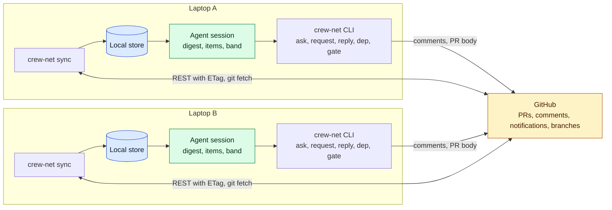
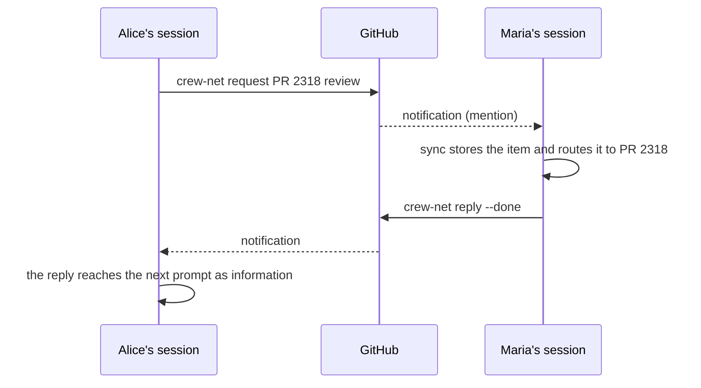

# crew-net

[](https://github.com/alexei-led/crew-net/actions/workflows/ci.yml)
[](LICENSE)

crew-net connects the coding agents of one team across laptops. GitHub is the
only transport. There is no server and no daemon.

## The problem

Two agents on one laptop can talk before they push. Agents on different laptops
find each other late, in one of three ways:

- **A merge conflict** after both sides finish.
- **A red CI run** after a rebase onto work that changed under them.
- **An out-of-order deploy.** A merge to `main` is a deploy. A consumer that
  merges before its producer breaks production.

## How it works

`crew-net sync` runs in short passes on each laptop. It reads GitHub, runs `git
fetch` and writes a local store. Agent sessions read that store. Messages are normal
PR and Issue comments with an `@mention`, so a colleague without crew-net still gets
the notification.





## What the agent sees

At session start, the agent gets a short digest of the repo. The band above the
prompt shows it too:

```text
crew-net · acme/app · feat/users-tier
You     #2310 building  api/openapi/ (2 files)        depends on #2301 (open)
Others  maria   #2318 review   api/openapi/users.yaml  ⚠ conflicts with #2310
        dmitri  feat/billing  no PR, pushed 14 min ago  web/billing/
Inbox   maria asks on #2310: "Does #2310 need the new column first?"  12 min
```

## Install

You need Node 22+, `git`, and `gh` signed in (`gh auth login`). In Claude
Code, run:

```text
claude plugin marketplace add alexei-led/crew-net
claude plugin install crew-net@crew-net
```

Then run `crew-net doctor` in a repo. It names the next step if something is
missing. For Pi and Codex, see [docs/harnesses.md](docs/harnesses.md).

## Commands

| Command                     | Use                                            |
| --------------------------- | ---------------------------------------------- |
| `crew-net`                  | Show the digest for the current repo           |
| `crew-net who <paths>`      | Show open work that touches these paths        |
| `crew-net ask <@login\|PR>` | Ask a question. It stays open until answered   |
| `crew-net inbox`            | Show unread items and open requests, both ways |
| `crew-net dep add <PR>`     | Merge this PR only after PR `<PR>` has merged  |

All commands and settings are in the [user guide](docs/user-guide.md).

## Docs

- [User guide](docs/user-guide.md): setup, daily use, commands, settings, limits.
- [Design](docs/design.md): how it works and why.
- [Other harnesses](docs/harnesses.md): Pi and Codex, and the `AGENTS.md` snippet.
- [Releasing](docs/releasing.md): version, tag and the release workflow.
- [Claude Code plugin](plugin/README.md), [repo kit](repo-kit/README.md),
  [end-to-end results](e2e/README.md).
- [Changelog](CHANGELOG.md) and [agent instructions](AGENTS.md).

## Develop

```sh
bun install --frozen-lockfile
make check   # types, lint, tests, dependency rules, plugin tests
```
