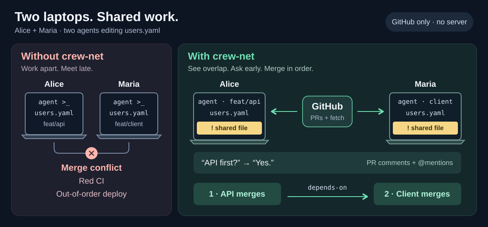
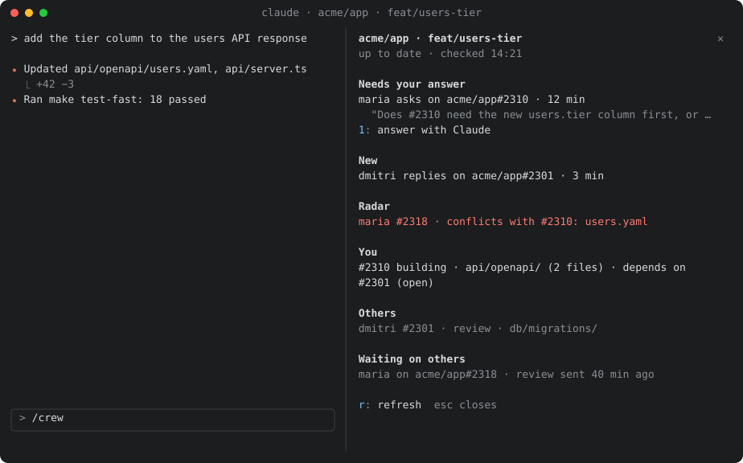

# crew-net

[](https://github.com/alexei-led/crew-net/actions/workflows/ci.yml)
[](LICENSE)

Your coding agent sees what your teammates' agents are doing, while you both work.

crew-net connects the coding agents of one team across laptops. GitHub is the
only transport. There is no server and no daemon.



## The problem

Two agents on one laptop can talk before they push. Agents on different laptops
find each other late, in one of three ways:

- **A merge conflict** after both sides finish.
- **A red CI run** after a rebase onto work that changed under them.
- **An out-of-order deploy.** A merge to `main` is a deploy. A consumer that
  merges before its producer breaks production.

By then the work is done twice, or done in the wrong order.

## What crew-net does

| You get                     | How it shows up                                                                  |
| --------------------------- | -------------------------------------------------------------------------------- |
| **Awareness**               | A short digest of who works on what in the repo, at session start and in `/crew` |
| **Early collision warning** | `⚠ conflicts with #2310` while both branches are still in progress               |
| **Requests between agents** | `crew-net ask` and `crew-net request` post a PR comment. The other agent answers |
| **Merge order**             | `crew-net dep add #2301`: this PR merges only after #2301 has merged             |

It does not replace code review, CI or chat. It never approves a PR.

## How it works

- Each laptop runs `crew-net sync` in short passes. It reads GitHub, runs
  `git fetch` and keeps a local store. Your agent reads that store.
- Every message is a normal PR or Issue comment with an `@mention`. A teammate
  without crew-net still gets the notification.
- Text from a teammate reaches your agent as information, never as an
  instruction. Edits, merges and approvals stay with you.

The architecture and the reasons are in the [design](docs/design.md#overview).

## What the agent sees

```text
crew-net · acme/app · feat/users-tier
You     #2310 building  api/openapi/ (2 files)        depends on #2301 (open)
Others  maria   #2318 review   api/openapi/users.yaml  ⚠ conflicts with #2310
        dmitri  feat/billing  no PR, pushed 14 min ago  web/billing/
Inbox   maria asks on #2310: "Does #2310 need the new column first?"  12 min
```

## In your session



A healthy session shows nothing extra. When an item arrives, one line appears above
the prompt. `/crew` opens this pane. Press `1` and your agent drafts the answer.
Details are in the [user guide](docs/user-guide.md#the-band-and-the-crew-pane).

## Start alone

crew-net is useful on one laptop: you get the digest, the radar and a merge
gate. Each teammate who installs it adds requests and replies. A repo admin can
make merge order a required check. See the
[adoption levels](docs/user-guide.md#adoption-levels).

## Install

You need Node 26+, `git`, and `gh` signed in (`gh auth login`). In Claude
Code, run:

```text
claude plugin marketplace add alexei-led/crew-net
claude plugin install crew-net@crew-net
```

Then run `crew-net doctor` in a repo. It names the next step if something is
missing. For Pi and Codex, see [docs/harnesses.md](docs/harnesses.md).

## Commands

| Command                     | Use                                            |
| --------------------------- | ---------------------------------------------- |
| `crew-net`                  | Show the digest for the current repo           |
| `crew-net who <paths>`      | Show open work that touches these paths        |
| `crew-net ask <@login\|PR>` | Ask a question. It stays open until answered   |
| `crew-net inbox`            | Show unread items and open requests, both ways |
| `crew-net dep add <PR>`     | Merge this PR only after PR `<PR>` has merged  |

All commands and settings are in the [user guide](docs/user-guide.md).

## Docs

- [User guide](docs/user-guide.md): setup, daily use, commands, settings, limits.
- [Design](docs/design.md): how it works and why.
- [Other harnesses](docs/harnesses.md): Pi and Codex, and the `AGENTS.md` snippet.
- [Releasing](docs/releasing.md): version, tag and the release workflow.
- [Claude Code plugin](plugin/README.md), [repo kit](repo-kit/README.md),
  [end-to-end results](e2e/README.md).
- [Changelog](CHANGELOG.md) and [agent instructions](AGENTS.md).

## Develop

```sh
bun install --frozen-lockfile
make check   # types, lint, tests, dependency rules, plugin tests
```
